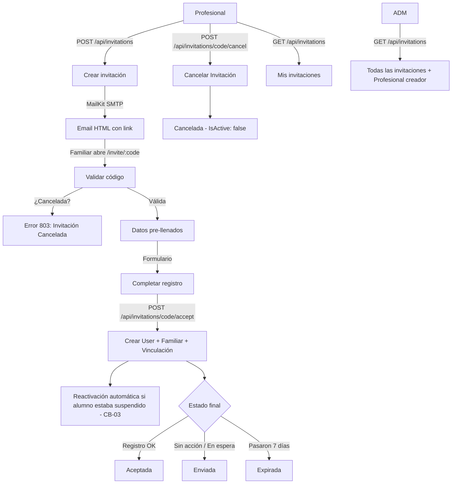

# Proceso 07 — Gestión de Invitaciones

**Área:** Gestión de Usuarios

## Descripción
Proceso de generación, envío, consulta, cancelación y aceptación de invitaciones por email para el registro de familiares en la plataforma. El profesional genera una invitación con el email del familiar y la persona asociada; el sistema envía un email SMTP con un link único de registro; el profesional puede cancelarla en caso de error o desestimación; el familiar completa el formulario y queda vinculado automáticamente, reactivando al alumno si este se encontraba preventivamente suspendido por falta de tutor legal.

## Participantes
- **Profesional** — Genera invitaciones para familiares de sus personas asignadas y puede cancelarlas mientras estén pendientes.
- **Admin** — Consulta todas las invitaciones de la institución, visualizando quién las emitió y su estado (incluyendo canceladas).
- **Familiar** — Recibe email y se registra mediante el enlace único.

## Pasos del proceso

### 1. Crear Invitación
El profesional ingresa email, nombre, apellido y relación del familiar, y selecciona la persona con discapacidad asociada. El sistema genera un código único y envía un email SMTP.
- **Endpoint:** `POST /api/invitations`
- **Frontend:** `/pro/invitations` (formulario de invitación)

### 2. Envío de Email
El sistema envía un email HTML con un botón de acción que enlaza a `/invite/:code`.
- **Infraestructura:** SMTP vía MailKit
- **Templates:** HTML con datos pre-llenados del familiar y la persona
- **Configuración:** Ethereal para desarrollo, configurable para producción

### 3. Validación de Código
Cuando el familiar abre el link, el sistema valida el código y devuelve los datos pre-llenados.
- **Endpoint:** `GET /api/invitations/{code}` (público, sin JWT)
- **Validaciones:** Código existente, no expirado, no aceptado y no cancelado (`IsActive = true`).

### 4. Aceptación y Registro
El familiar completa el formulario de registro. El sistema crea en una transacción: el usuario, el perfil de familiar y la vinculación (`PersonRepresentative`) con la persona.
- **Endpoint:** `POST /api/invitations/{code}/accept` (público)
- **Frontend:** `/invite/:code` (formulario público)
- **Reactivación Automática (CB-03):** Si el estudiante asociado se encontraba suspendido preventivamente por falta de tutores activos, la aceptación de la invitación lo reactiva automáticamente junto a su cuenta de usuario (`Person.IsActive = true`, `User.IsActive = true`).

### 5. Cancelación de Invitación (Profesional)
El profesional emisor puede cancelar cualquier invitación en estado "Enviada".
- **Endpoint:** `POST /api/invitations/{code}/cancel`
- **Frontend:** `/pro/invitations` (botón de acción "Cancelar" con modal interactivo de confirmación).
- **Efecto y Seguridad:** La invitación pasa a `IsActive = false`. Todo intento posterior de acceder al enlace (`GET /api/invitations/{code}`) o enviar el registro (`POST /api/invitations/{code}/accept`) es bloqueado inmediatamente con `ErrorCode.InvitationCancelled` (código 803: *"Esta invitación ha sido cancelada por la institución."*).

### 6. Consulta y Auditoría de Invitaciones
El profesional visualiza sus propias invitaciones; el administrador visualiza todas las invitaciones de la institución, incluyendo quién la envió (`createdByProfessionalName`).
- **Endpoint:** `GET /api/invitations` (paginado, con filtros por estado: Todos, Enviadas, Aceptadas, Expiradas, Canceladas).
- **Frontend profesional:** `/pro/invitations`
- **Frontend admin:** `/admin/invitations`

### Estados de invitación
- **Enviada** (Badge Azul / Info) — Email enviado, pendiente de aceptación.
- **Aceptada** (Badge Verde / Success) — Familiar completó el registro.
- **Expirada** (Badge Rojo / Danger) — Código venció (7 días) sin ser usado.
- **Cancelada** (Badge Gris / Secondary) — Cancelada por el profesional emisor; enlace inhabilitado.

## Diagrama de flujo

