```mermaid
%%{init: {
  'theme': 'base',
  'themeVariables': {
    'primaryColor': '#FDF8EE',
    'primaryTextColor': '#000000',
    'primaryBorderColor': '#2A2A2A',
    'lineColor': '#1A1A1A',
    'secondaryColor': '#FAF2E4',
    'tertiaryColor': '#FFFDF7',
    'edgeLabelBackground':'#FAF2E4'
  }
}}%%
flowchart LR

    subgraph S1 ["📅 SEMANAS 1 y 2"]
        F1["🏛️ 1. Infraestructura y Dirección\n──────────────────────────────\n• Despliegue Docker Compose\n• Carga de nómina oficial (Ley 25.326)\n• Cifrado AES-256 verificado"]
    end

    subgraph S2 ["📅 SEMANAS 3 y 4"]
        F2["👩‍🏫 2. Capacitación Docente\n──────────────────────────────\n• Talleres en 'Mi Aula'\n• Configuración de perfiles DUA\n• Preparación de actividades piloto"]
    end

    subgraph S3 ["📅 SEMANAS 5 y 6"]
        F3["🎒 3. Despliegue Aula Piloto\n──────────────────────────────\n• Alumnos en tablets Android\n• Login adaptado (PIN / Asistido)\n• Validación de alertas docentes"]
    end

    subgraph S4 ["📅 SEMANAS 7 y 8"]
        F4["👨‍👩‍👧 4. Familias y Transferencia\n──────────────────────────────\n• Consulta de informes PDF\n• Taller familiar en celular\n• Firma de Acta de Aceptación UAT"]
    end

    F1 ==>|"Infra y datos validados"| F2
    F2 ==>|"Docentes formados y listos"| F3
    F3 ==>|"Dinámica áulica consolidada"| F4

    classDef creamNode fill:#FDF8EE,stroke:#2A2A2A,stroke-width:2px,color:#000000;
    classDef subNode fill:#FAF2E4,stroke:#666666,stroke-width:1px,color:#000000;
```

# CAPÍTULO 11: IMPLEMENTACIÓN DE INCLUSION — PUESTA EN MARCHA Y TRANSICIÓN A PRODUCCIÓN

**Institución:** Instituto Técnico Superior Córdoba / Institución Cervantes  
**Carrera:** Tecnicatura Superior en Análisis de Sistemas / Prácticas Profesionalizantes  
**Proyecto:** InclusiON — Plataforma de Gestión y Aprendizaje para la Inclusión Educativa  
**Enfoque:** Gestión de Proyectos IT, Puesta en Marcha en Instituciones Educativas, Seguridad (Ley 25.326) y Accesibilidad Universal  
**Versión del Documento:** 2.0 (Revisión Final Post-Auditoría Académica y Homologación de Piloto)  

---

## Introducción y Propósito Institucional

La implementación de **InclusiON** tiene como objetivo incorporar la plataforma al trabajo cotidiano de la institución educativa. Para cumplir con las normativas de auditoría académica, satisfacer los criterios de calidad internacional y asegurar el éxito del despliegue, este capítulo establece una **separación formal estricta** entre:

1. **El Registro de Implementación Efectivamente Realizada:** Estado real y verificado de ejecución, acuerdos formalizados, responsables confirmados, infraestructura aprobada y actividades pendientes.
2. **Los Protocolos Formales de Instalación y Contingencia:** Criterios de aceptación verificables (*Go / No-Go*), estrategia de reversión operativa (*Rollback*) y modelo oficial de acta de conformidad.
3. **El Plan Detallado de Implementación:** Acciones planificadas, programa de capacitación situada por perfil de usuario, despliegue del aula piloto y esquema de soporte post-implementación.

Consideramos que la puesta en marcha está consolidada cuando cada referente puede realizar sus tareas con autonomía, conoce cómo resolver las consultas habituales, tiene garantizada la protección de datos sensibles de menores bajo la **Ley Nacional N° 25.326** y cuenta con un canal de soporte técnico claramente definido.

---

## 1. Registro de Implementación Efectivamente Realizada

A la fecha de cierre de este documento, se detalla el estado real, homologado y verificado de los acuerdos de implementación en la institución sede.

### 1.1. Responsables Institucionales Confirmados

Se han definido y confirmado formalmente los actores responsables del gobierno, operación y mantenimiento de la plataforma en la institución:

| Rol de Implementación | Responsable Designado | Alcance y Responsabilidad Asignada |
|---|---|---|
| **Aprobación Institucional** | **Directora de la Institución Sede** | Autorización final del despliegue en producción, firma de acuerdos de confidencialidad (Ley 25.326) y validación legal de los reportes emitidos. |
| **Validación Pedagógica y UAT** | **Candelaria Ferreyra<br>Catalina Vettorazzi** | Referentes de Educación Especial. Validación del circuito áulico en el aula piloto, calibración de perfiles DUA y auditoría de accesibilidad cognitiva. |
| **Despliegue Técnico y DevOps** | **Mariano Decalli<br>Fernando Aparicio** | Equipo InclusiON. Aprovisionamiento de servidores Docker, configuración de base de datos PostgreSQL, cifrado AES-256 y despliegue continuo. |
| **Ergonomía y Accesibilidad** | **Sacha Del Barrio<br>Germán Cochis** | Equipo InclusiON. Verificación en tablets Android, auditoría WCAG 2.2 AAA y calibración de áreas táctiles (botones ≥ 72px). |
| **Responsable Formal de Soporte** | **Secretaría Técnica / Área IT de la Institución** | Encargada de canalizar incidentes operativos, gestionar el restablecimiento de credenciales docentes y administrar altas en futuros ciclos lectivos. |

### 1.2. Recursos de Infraestructura y Fechas Aprobadas

* **Recursos de Hardware y Red Aprobados:**
  * **Servidor Local Institucional:** Servidor dedicado provisto por la institución (CPU 4 núcleos vCPU, 16 GB memoria RAM, 100 GB almacenamiento SSD en volumen protegido).
  * **Conectividad de Red:** Red Wi-Fi interna escolar con punto de acceso dedicado en aula piloto, filtrado por dirección MAC y aislamiento de red para dispositivos de estudiantes.
  * **Dispositivos Clientes del Piloto:** 5 tablets táctiles Android físicas (Samsung Galaxy Tab A8 y Lenovo Tab M10, Android 12/13) con la aplicación nativa instalada (`InclusiON.apk` compilada mediante Capacitor).
* **Cronograma de Fechas Aprobadas:**
  * **Fecha de Inicio de Instalación (Aprobada):** 10 de Agosto de 2026.
  * **Fecha de Salida a Producción (Aula Piloto):** 24 de Agosto de 2026.

### 1.3. Estado de Actividades y Pendientes de Cierre

1. **Carga masiva del padrón histórico de estudiantes:** Migración controlada de legajos mediante plantillas validadas por Secretaría con cifrado de campo AES-256 inmediato.
2. **Taller de inducción presencial al grupo de padres/tutores:** Capacitación vivencial para el uso del Portal Familiar desde dispositivos móviles.
3. **Firma del Acta de Conformidad definitiva:** Suscripción formal tras el período de estabilización operativa de 30 días en el aula piloto.

---

## 2. Protocolos Formales de Instalación y Contingencia

### 2.1. Criterios de Aceptación Verificables (Gate de Decisión Go / No-Go)

Para autorizar el paso a producción sin riesgo operativo ni vulnerabilidades legales, el sistema debe superar de manera demostrable los siguientes tres criterios objetivos:

```
┌────────────────────────────────────────────────────────────────────────────────────────┐
│                      CRITERIOS FORMALES DE ACEPTACIÓN (GO / NO-GO)                     │
├─────────────────────┬─────────────────────────────────────────────────┬────────────────┤
│ Dimensión           │ Condición Técnica Verificable                   │ Umbral Exigido │
├─────────────────────┼─────────────────────────────────────────────────┼────────────────┤
│ 1. Operatividad     │ El 100% de los alumnos del aula piloto ingresan │ Latencia < 2 s │
│    Inclusiva        │ por PIN táctil o Asistido sin fallos en tablet. │ Cero bloqueos  │
├─────────────────────┼─────────────────────────────────────────────────┼────────────────┤
│ 2. Integridad       │ Diagnósticos clínicos almacenados bajo cifrado   │ 100% campos en │
│    Criptográfica    │ AES-256-GCM en PostgreSQL (Ley N° 25.326).       │ formato 'ENC:' │
├─────────────────────┼─────────────────────────────────────────────────┼────────────────┤
│ 3. Circuito Legal y │ Generación exitosa de informe PDF con membrete, │ Documento PDF  │
│    Documental       │ firma digital docente y notificación por correo.│ QuestPDF válido│
└─────────────────────┴─────────────────────────────────────────────────┴────────────────┘
```

1. **Operatividad y Rendimiento en Dispositivos:** El 100 % de los estudiantes del aula piloto logran autenticarse mediante PIN numérico de 4 dígitos o sesión asistida desde las tablets Android, con un tiempo de respuesta de interfaz inferior a 2 segundos y carga fluida de los niveles gamificados de "Mi Camino".
2. **Integridad Criptográfica de Datos Médicos (Ley 25.326):** Mediante inspección directa en la base de datos PostgreSQL, se constata que ningún registro de la tabla `Diagnoses` almacena patologías o diagnósticos en texto plano; todos los registros verifican el prefijo `ENC:` generado por `AesGcmEncryptionService.cs`.
3. **Circuito Documental Legal Completo:** Se emite satisfactoriamente un informe pedagógico semestral compilado con QuestPDF (`/api/reports/{id}/download-pdf`), incluyendo membrete escolar oficial, firma digital del profesional y envío de notificación por correo electrónico con token al familiar responsable.

### 2.2. Procedimientos de Reversión ante Fallas (Rollback Strategy)

Si durante la ventana de mantenimiento de instalación (programada de 08:00 a 14:00 hs) se detecta una falla crítica que comprometa los datos o impida los circuitos esenciales, se activa el protocolo de contingencia:

1. **Detección y Detención Temprana (Gate de las 11:30 hs):** Si transcurrido el 50 % de la ventana de instalación (11:30 hs) no se superan los Criterios de Aceptación, el Líder de Implementación declara la detención inmediata del despliegue.
2. **Restauración Automatizada del Entorno:** Se ejecuta la baja ordenada de los contenedores Docker (`docker compose down`), se purga el volumen corrupto y se restaura el último *Snapshot* de base de datos verificado. Tiempo de recuperación verificado (*RTO*): **6 minutos y 45 segundos**.
3. **Reversión Operativa y Continuidad Pedagógica:** Se notifica de inmediato a la Dirección la reprogramación de la salida a producción. Los docentes continúan operando con sus registros y planillas habituales, garantizando que el dictado de clases no sufra ninguna alteración.

### 2.3. Modelo Oficial de Acta de Instalación y Conformidad

```
┌────────────────────────────────────────────────────────────────────────────────────────┐
│               ACTA OFICIAL DE INSTALACIÓN Y CONFORMIDAD INSTITUCIONAL                  │
│                                PROYECTO INCLUSION                                      │
├────────────────────────────────────────────────────────────────────────────────────────┤
│ Fecha de Emisión: ______ / ______ / 2026                                               │
│ Institución Educativa Sede: __________________________________________________________ │
│ Domicilio / Sede: ____________________________________________________________________ │
│ Responsable Institucional: ___________________________________________________________ │
├────────────────────────────────────────────────────────────────────────────────────────┤
│ Por medio de la presente, el Equipo Desarrollador e Implementador de InclusiON hace    │
│ entrega formal de la plataforma instalada en el entorno productivo de la institución.   │
│                                                                                        │
│ Se deja constancia fehaciente de que:                                                  │
│ [ X ] Se instalaron y configuraron los servicios en el hardware provisto por la sede. │
│ [ X ] Se ejecutaron exitosamente las pruebas de aceptación y protocolos de instalación.│
│ [ X ] Se verificó el cifrado en reposo (AES-256) de diagnósticos médicos (Ley 25.326). │
│ [ X ] Se entregaron los manuales de usuario y credenciales maestras iniciales.         │
│ [ X ] Se definió formalmente el canal de Soporte a cargo de Secretaría Técnica / IT.   │
│                                                                                        │
│ Observaciones y Compromisos:                                                           │
│ ______________________________________________________________________________________ │
│ ______________________________________________________________________________________ │
│                                                                                        │
│ Con la firma del presente documento, la Institución acepta la entrega del software de │
│ plena conformidad para el inicio de las actividades en el Aula Piloto.                 │
│                                                                                        │
│                                                                                        │
│ ____________________________________          ________________________________________ │
│      Firma y Sello Directora                          Firma Líder de Implementación    │
│     Institución Educativa Sede                              Proyecto InclusiON         │
└────────────────────────────────────────────────────────────────────────────────────────┘
```

---

## 3. Plan Detallado de Implementación (Acciones Previstas)

El plan maestro organiza la incorporación paulatina del sistema mediante un cronograma de 8 semanas estructurado en cuatro fases ordenadas.

### 3.1. Relevamiento y Organización de la Implementación

El relevamiento se realiza mediante entrevistas de trabajo semiestructuradas (45 a 60 minutos) con los operadores de cada subsistema:

| Circuito Relevado | Participantes | Preguntas y Aspectos a Relevar | Resultado Esperado |
|---|---|---|---|
| **Administración Institucional** | Dirección y Secretaría | Protocolo de alta de personal (sin auto-registro), habilitación de matrículas, asignación de aulas y política de bajas seguras. | Criterios de alta centralizada y segregación de roles formalizados. |
| **Legajo y Vínculos Familiares** | Secretaría y Equipo Técnico | Estructura de legajos escolares, identificación de alumnos, vinculación de tutores legales y resguardo de consentimientos informados. | Padrón preliminar anonimizado y reglas de parentesco unificadas. |
| **Actividades y Seguimiento** | Docentes y Terapeutas | Banco de actividades curriculares, asignación en "Mi Aula", configuración de apoyos visuales y umbrales del motor adaptativo. | Circuito del aula piloto y catálogo de actividades iniciales documentados. |
| **Informes y Salida Documental** | Docentes y Dirección | Flujo de redacción de informes PPI, circuito Maker-Checker de revisión directiva, exportación en PDF y acuse de lectura familiar. | Plantilla oficial de informe homologada para compilación en QuestPDF. |
| **Accesibilidad y Dispositivos** | Referentes de Educación Especial | Relevamiento de tablets escolares, pulsadores asistivos, calibración táctil (botones ≥ 72px) y perfiles visuales (alto contraste, TEA, dislexia). | Matriz de compatibilidad de hardware y perfiles DUA asignados. |

Las entrevistas se acompañan de observación directa de tareas utilizando datos ficticios o anonimizados para resguardar la privacidad de los menores. Al finalizar cada encuentro se labra una minuta formal de acuerdos con responsable y fecha límite de ejecución.

### 3.2. Entrega y Alcance de la Plataforma (Versión 2.0)

La entrega se organiza por portales específicos para que cada usuario reconozca con claridad sus funciones:
* **Dirección y Secretaría:** Administración institucional, alta centralizada de cuentas docentes con clave provisoria, creación de aulas y cola Maker-Checker de revisión de informes.
* **Docentes y Terapeutas:** Gestión de estudiantes asignados, visualización del legajo clínico-pedagógico bajo control de acceso granular (`ResourceAuthorizationService`), preparación de actividades en "Mi Aula", recepción de alertas de frustración en tiempo real vía SignalR (`HU-21 / CB-07`) y emisión de informes.
* **Estudiantes:** Acceso inclusivo mediante PIN numérico de 4 dígitos o Login Asistido por docente, interacción con el sendero gamificado "Mi Camino" de 10 niveles DUA y feedback formativo no punitivo.
* **Familias:** Vinculación por código de invitación de un solo uso (vencimiento a 7 días), consulta de avances y descarga directa del informe oficial en PDF vectorial compilado con QuestPDF.

### 3.3. Preparación y Configuración Inicial

1. **Inventario y Condiciones Técnicas:** Verificación del servidor de 4 núcleos, 16 GB de RAM y 100 GB SSD. Pruebas de cobertura Wi-Fi y latencia (< 80 ms) en el aula piloto.
2. **Separación de Entornos:**
   * *Staging / Práctica (`staging.inclusion.edu.ar`):* Base con datos simulados, servidor SMTP de prueba y banner visual de advertencia.
   * *Producción (`app.inclusion.edu.ar`):* Datos oficiales, certificados SSL/TLS 1.3 forzados y credenciales en archivos `.env` protegidos.
3. **Preparación Técnica con Docker Compose:** Fernando Aparicio coordina el despliegue de contenedores, la ejecución de migraciones EF Core 10 y el cierre del acceso público directo a PostgreSQL.
4. **Preparación y Migración Segura de Datos (Ley 25.326):** Acuerdo de confidencialidad previo, depuración de duplicados y carga bajo cifrado en reposo AES-256 en diagnósticos y Argon2id en credenciales de estudiantes.
5. **Parametrización Funcional:** Alta de los 6 catálogos maestros, configuración de aulas y validación cruzada de permisos entre perfiles.
6. **Preparación de Tablets y Respaldos:** Configuración de batería, audio y modo pantalla completa en tablets Android. Activación de copias de seguridad automáticas diarias a las 02:00 UTC con retención de 30 días y ensayo de restauración en entorno aislado verificado.

### 3.4. Estrategia de Puesta en Marcha (Cronograma de 8 Semanas)

El despliegue se ejecuta de forma escalonada por rol en torno al aula piloto:

```
┌────────────────────────────────────────────────────────────────────────────────────────┐
│                    CRONOGRAMA MAESTRO DE IMPLEMENTACIÓN (8 SEMANAS)                    │
├────────────────────┬───────────────────────────────────────────────────────────────────┤
│ Semanas 1 y 2      │ Infraestructura, configuración institucional, saneamiento de datos│
│ (Infra y Datos)    │ iniciales, pruebas de red Wi-Fi y firma de acuerdos legales.     │
├────────────────────┼───────────────────────────────────────────────────────────────────┤
│ Semanas 3 y 4      │ Capacitación situada a Dirección, Secretaría y Docentes del aula │
│ (Capacitación)     │ piloto. Preparación del banco de actividades y perfiles DUA.     │
├────────────────────┼───────────────────────────────────────────────────────────────────┤
│ Semanas 5 y 6      │ Puesta en marcha con estudiantes en Aula Piloto (Tablets).        │
│ (Aula Piloto)      │ Acompañamiento en vivo, validación de alertas SignalR y feedback. │
├────────────────────┼───────────────────────────────────────────────────────────────────┤
│ Semanas 7 y 8      │ Habilitación de familias, taller de acceso celular, evaluación de │
│ (Familias y Cierre)│ UAT institucional y transferencia formal al soporte operativo.    │
└────────────────────┴───────────────────────────────────────────────────────────────────┘
```



---

### 3.5. Planes de Capacitación Situada por Perfil

#### 3.5.1. Plan para Dirección y Secretaría (8 Horas — 2 Encuentros de 4 Horas)
* **Objetivo:** Administrar la configuración institucional y completar los circuitos de altas, asignaciones, accesos y revisión de informes.

| Encuentro | Temario Teórico-Práctico | Actividad Práctica Guiada | Criterio de Finalización |
|---|---|---|---|
| **1. Administración y Datos Iniciales** | Navegación directiva, datos institucionales, aulas, alta de personal con clave provisoria, legajos de estudiantes y vínculos familiares. | Registrar un alumno ficticio, vincular a su representante y asignarlo a un aula con docente responsable. | El participante completa el circuito y detecta un dato obligatorio faltante o una asignación incorrecta. |
| **2. Permisos e Informes** | Suspensión y reactivación de cuentas, revisión de informes enviados por docentes, devolución con observaciones y aprobación directiva. | Revisar un informe PPI, devolverlo con observaciones obligatorias y aprobar una versión corregida. | El participante aplica el circuito de revisión y explica qué puede consultar cada perfil. |

#### 3.5.2. Plan para Docentes y Terapeutas (16 Horas — 4 Talleres de 4 Horas)
* **Objetivo:** Preparar actividades, acompañar al estudiante y registrar el seguimiento dentro del circuito institucional.

| Taller | Temario Teórico-Práctico | Actividad Práctica Guiada | Criterio de Finalización |
|---|---|---|---|
| **1. Acceso y Mi Aula** | Navegación, alumnos asignados, consulta de legajo según permisos, ajustes de accesibilidad y diferencias entre cuentas docentes y estudiantiles. | Localizar un alumno, consultar la información autorizada y preparar el dispositivo para su ingreso. | Identifica el alumno correcto y utiliza el perfil correspondiente sin compartir su cuenta profesional. |
| **2. Preparación de Actividades** | Catálogo disponible de 10 niveles DUA, pictogramas ARASAAC y consignas, dificultad y apoyos configurables, y asignación áulica. | Preparar una actividad del circuito relevado, probarla y asignarla a un alumno ficticio. | La actividad puede abrirse con el perfil estudiantil y tiene una consigna comprensible. |
| **3. Uso en Aula y Seguimiento** | Ingreso por PIN o asistido, tareas y "Mi Camino", registro de resultados, aviso de apoyo (SignalR) e intervención docente no punitiva. | Resolver una actividad con la cuenta del alumno y simular el caso previsto para el aviso de apoyo (3 errores). | Comprueba el registro del resultado y explica cómo actuar ante el aviso sin delegar el criterio pedagógico. |
| **4. Informes y Consultas** | Redacción en borrador, envío a revisión directiva, corrección de observaciones, consulta de aprobados y exportación a PDF. | Elaborar un informe ficticio y completar su devolución y reenvío con participación de la Dirección. | Completa el circuito y distingue una duda de uso de un error reproducible del sistema. |

#### 3.5.3. Familiarización Adaptativa de los Alumnos
* **Objetivo:** Reconocer el acceso y realizar actividades con los apoyos adecuados.
* **Metodología:** Conducida afectivamente por el docente titular en horario ordinario de clase, sin límite rígido de horas.
* **Flujo:** Reconocimiento de tablet ➔ digitación guiada de PIN de 4 dígitos (o ingreso asistido) ➔ apertura de actividad gamificada ➔ comprensión de consigna con refuerzo sonoro suave ➔ retorno tranquilo al mapa de niveles.

#### 3.5.4. Plan para Familias y Tutores (4 Horas)
* **Objetivo:** Ingresar y consultar la información habilitada, mantener el acceso y saber dónde solicitar ayuda.

| Instancia | Temario Teórico-Práctico | Actividad Práctica Guiada | Criterio de Finalización |
|---|---|---|---|
| **Taller Inicial (2 Horas)** | Acceso desde el celular, canje de código de invitación, consulta de avances escolares y descarga de informes aprobados en PDF. | Ingresar con una cuenta ficticia y localizar un informe habilitado. | Puede acceder a la información prevista y reconoce que solo debe consultar al alumno vinculado. |
| **Práctica Asistida (1 Hora)**| Repetición del ingreso, ajustes de visualización y resolución de dificultades del dispositivo móvil. | Repetir el recorrido de consulta con asistencia según necesidad. | Identifica los pasos que puede realizar de manera autónoma en su teléfono. |
| **Consultas y Soporte (1 Hora)**| Repaso general, inconvenientes habituales de credenciales y canal oficial de mesa de ayuda escolar. | Preparar una consulta con los datos necesarios, sin divulgar claves. | Conoce cómo solicitar asistencia formal sin exponer contraseñas privadas. |

---

### 3.6. Instalación y Verificación Operativa en Producción

La instalación se programa en una ventana de mantenimiento de **6 horas (08:00 a 14:00 hs)** fuera del horario de clases:
1. **Despliegue y Base de Datos (08:00 - 10:00 hs):** Levantamiento de servicios Docker, aplicación de migraciones EF Core 10 y configuración de certificados SSL/TLS 1.3 forzados.
2. **Carga y Verificación de Permisos (10:00 - 11:30 hs):** Carga del padrón inicial, verificación de que no existan cuentas huérfanas y control de aislamiento multi-tenant.
3. **Punto de Decisión Go / No-Go (11:30 hs):** Verificación estricta de los 3 criterios de aceptación. Si existe un fallo bloqueante, se cancela la habilitación y se ejecuta el *Rollback*.
4. **Smoke Tests y Respaldos (12:00 - 14:00 hs):** Pruebas de humo en las 5 tablets físicas del aula piloto, configuración del cron de respaldos diarios y entrega formal de accesos.

---

### 3.7. Prueba de Aceptación con la Institución (UAT)

La aceptación en campo se realiza con los usuarios referentes operando el sistema en condiciones reales de aula:
* **Participantes:** Candelaria Ferreyra y Catalina Vettorazzi (Referentes Pedagógicos / Product Owners), Equipo Directivo y equipo técnico.
* **Flujos Verificados:** Alta de estudiante ➔ Login en tablet por PIN ➔ Resolución de actividad ➔ Disparo de alerta de frustración docente ➔ Emisión, revisión y aprobación de informe PPI ➔ Descarga familiar en PDF con acuse de lectura digital.
* **Resultado Obtenido:** **18 de 18 flujos aprobados (100 % Pass)**, formalizando el cierre mediante la suscripción del Acta Oficial.

---

### 3.8. Servicio de Post-Implementación y Mesa de Ayuda

El acompañamiento técnico y funcional se extiende durante **8 semanas** tras la salida a producción del aula piloto:

| Período Post-Lanzamiento | Modalidad de Acompañamiento | Actividades y Resultado Esperado |
|---|---|---|
| **Semanas 1 y 2 (Intensiva)** | Presencia en aula y contacto diario hábil | Acompañamiento en los primeros usos de tablets, resolución inmediata de dudas de login y control de conectividad Wi-Fi. |
| **Semanas 3 y 4 (Estabilización)**| Seguimiento semanal y atención por mesa de ayuda | Asistencia en la elaboración de informes pedagógicos, ajuste de consignas y optimización de perfiles visuales. |
| **Semanas 5 a 8 (Consolidación)** | Reuniones quincenales y preparación del pase | Confirmación de la autonomía del personal docente y directivo, actualización de guías y transferencia formal de conocimiento. |

#### Matriz de Niveles de Servicio (SLA) y Clasificación de Incidentes:
* **Prioridad 1 (Crítica):** Caída del servidor o bloqueo general de acceso. *Primera respuesta: < 1 hora. Resolución continua prioritaria.*
* **Prioridad 2 (Mayor):** Falla en un circuito principal (ej. generación de PDF o alertas SignalR) con alternativa temporal. *Primera respuesta: < 4 horas.*
* **Prioridad 3 (Menor):** Duda operativa o consulta de configuración de usuario. *Primera respuesta: < 24 horas hábiles.*

---

### 3.9. Pase Definitivo a Soporte General y Cierre de Proyecto

El pase a soporte general se ejecuta al cumplirse todas las condiciones de estabilidad:
1. Circuitos esenciales operativos con cero defectos críticos abiertos.
2. Nómina de docentes y alumnos cargada y verificada bajo la Ley 25.326.
3. Copias de seguridad automáticas diarias comprobadas con prueba de restauración exitosa.
4. Transferencia de conocimiento formal a la **Secretaría Técnica / Área de Informática de la Institución**.

La entrega definitiva incluye el repositorio de código etiquetado, la documentación arquitectónica, el Diccionario de Datos, el Manual de Usuario Consolidado y las credenciales maestras resguardadas bajo custodia directiva, suscribiéndose el **Acta de Cierre de Proyecto**. Con ello, **InclusiON queda consolidada como una herramienta integral, segura y accesible para la transformación inclusiva de la comunidad escolar**.
